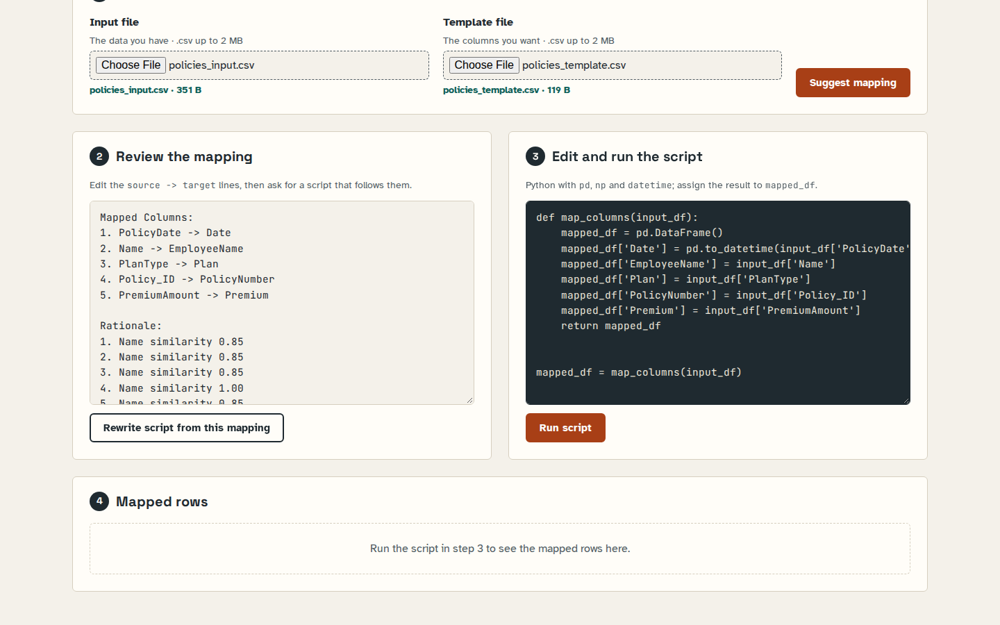
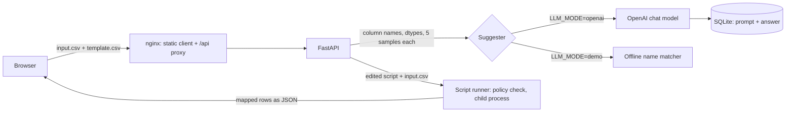
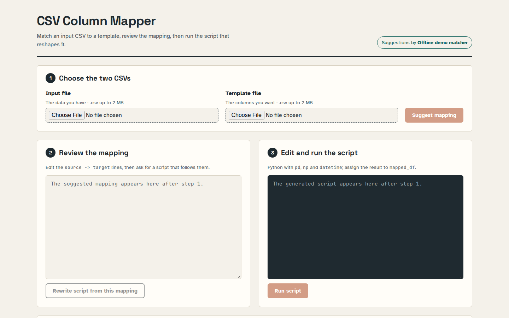
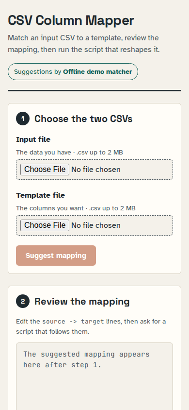
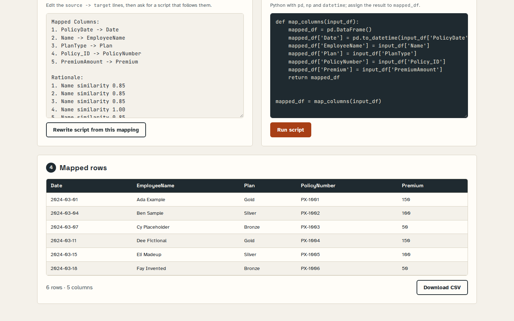
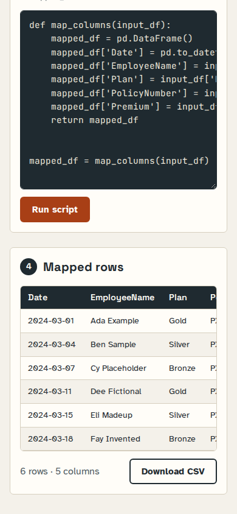
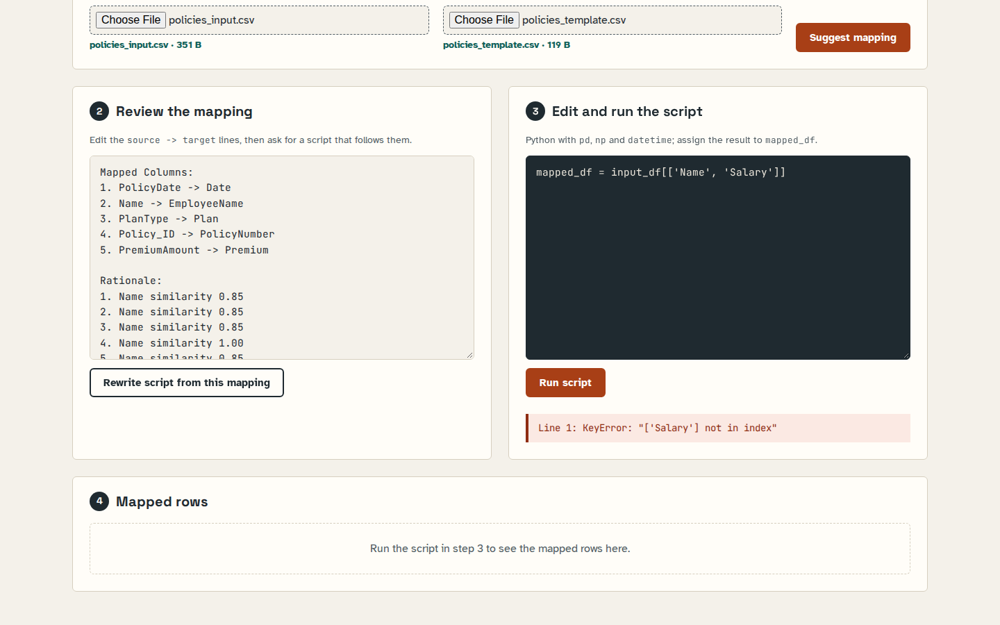

# CSV Column Mapper

Map the columns of one CSV onto the layout of another. You upload the data you have and a template
with the columns you want; the app suggests which column feeds which, writes a short pandas script
that performs the mapping, and lets you edit both before running the script and downloading the
result.

Suggestions come from an OpenAI model when a key is configured, or from an offline name matcher
when it is not, so the whole flow works without an account.



## Where this code comes from

This project started as a take-home assignment ("Zero App") by the GitHub user
[usmanasif](https://github.com/usmanasif); the original README's screenshots were hosted in that
user's repository. The FastAPI backend, the React client, the prompt templates and the idea of
storing prompts for later fine-tuning are that author's work. Later changes (the upload limits, the
contained script runner, the offline matcher, the tests, the Vite client and the Compose setup) were
made on top of it.

No licence file came with the original code, so none is included here. Ask the original author
before reusing it.

## How it works



1. **Suggest.** `POST /suggest_column_mapping/` reads both files, describes each column (name,
   dtype, up to five non-null sample values) and asks the suggester for a mapping plus a script that
   defines `map_columns(input_df)` and assigns `mapped_df`.
2. **Revise.** Sending the edited mapping back as `suggestion` asks for a script that follows your
   `source -> target` lines. The "Rationale" part is stripped before it goes into the prompt.
3. **Run.** `POST /column_mapper/` runs the (possibly edited) script against the input file and
   returns the rows. The browser builds the CSV download itself.

### Design notes

- **The script is untrusted.** It comes from a model and the user can edit it, so the API never
  `exec()`s it in its own process. A parse-time policy allows imports of `pandas`, `numpy`,
  `datetime`, `math` and `re` only, and rejects dunder access, `eval`/`open`/`getattr`-style
  builtins and every pandas/numpy reader or file writer (`read_*`, `to_csv`, `np.load`, `query`,
  ...). Scripts that pass run in a fresh interpreter with an empty environment (so no API key), a
  10 s timeout, a 1 GB memory cap and a zero file-size limit. This raises the bar a lot but is not a
  full sandbox, so both ports are bound to `127.0.0.1` and the app is meant to run locally.
- **Upload limits.** `.csv` extension and a CSV-ish content type, at most `MAX_UPLOAD_BYTES`
  (2 MB) and `MAX_COLUMNS` (200) per file, UTF-8 with or without a BOM. Each rejection names the
  file.
- **Offline matcher.** Splits names into words (`PolicyDate` -> `policy date`), treats `id`, `no`
  and `num` as "number", scores pairs by word overlap and similarity and assigns each input column
  at most once, strongest pairs first. Template columns whose samples are ISO dates get a
  `to_datetime(...).strftime('%Y-%m-%d')` conversion.
- **Stored prompts.** In OpenAI mode every prompt and answer is saved to SQLite (`llm_data`) as
  material for fine-tuning later. The prompt contains up to five sample values per column, so turn
  this off with `STORE_PROMPTS=false` when the files hold anything sensitive.

## Run it with Docker Compose

```bash
cp .env.example .env        # optional: add OPENAI_API_KEY, otherwise demo mode is used
docker compose up --build
```

Open <http://localhost:8080>, choose `docs/samples/policies_input.csv` as the input file and
`docs/samples/policies_template.csv` as the template, then click **Suggest mapping** and
**Run script**. The API is also published on <http://localhost:8000> (interactive docs at
`/docs`).

## Run it without Docker

Python 3.12 (`backend/.python-version`) and Node 22 (`front_end/.nvmrc`).

```bash
cd backend
python -m venv .venv && . .venv/bin/activate
pip install -r requirements-dev.txt
cp ../.env.example .env     # optional
uvicorn main:app --reload --port 8000
```

```bash
cd front_end
npm ci
npm run dev                 # http://localhost:5173, proxies /api to port 8000
```

Set `API_PROXY_TARGET` if the API runs elsewhere, or `VITE_API_URL` at build time to call it
directly (it must then be listed in `CORS_ORIGINS`).

## Configuration

All settings are environment variables; `.env.example` lists them with defaults.

| Variable | Default | Purpose |
| --- | --- | --- |
| `OPENAI_API_KEY` | empty | Enables the OpenAI suggester. |
| `LLM_MODE` | auto | `openai` or `demo`; auto picks `openai` when a key is set. |
| `OPENAI_MODEL` | `gpt-4o-mini` | Chat model used for suggestions. |
| `DATABASE_URL` | `sqlite:///./data/llmdatabase.db` | Where prompts and answers are stored. |
| `STORE_PROMPTS` | `true` | Set to `false` to store nothing. |
| `MAX_UPLOAD_BYTES` | `2097152` | Per-file upload limit. |
| `MAX_COLUMNS` | `200` | Per-file column limit. |
| `SCRIPT_TIMEOUT_SECONDS` | `10` | Wall-clock limit for one script run. |
| `CORS_ORIGINS` | `http://localhost:5173,http://localhost:8080` | Origins allowed to call the API directly. |

## API

Captured from the Compose stack in demo mode with the sample files (through the nginx `/api`
prefix; the API itself serves the same paths without it).

`GET /health`

```json
{"status": "ok", "llm_mode": "demo"}
```

`POST /suggest_column_mapping/` (multipart: `input_table`, `template_table`, optional `suggestion`)

```bash
curl -F input_table=@docs/samples/policies_input.csv \
     -F template_table=@docs/samples/policies_template.csv \
     http://localhost:8080/api/suggest_column_mapping/
```

```json
{
  "suggestion": "Mapped Columns:\n1. PolicyDate -> Date\n2. Name -> EmployeeName\n3. PlanType -> Plan\n4. Policy_ID -> PolicyNumber\n5. PremiumAmount -> Premium\n\nRationale:\n1. Name similarity 0.85\n2. Name similarity 0.85\n3. Name similarity 0.85\n4. Name similarity 1.00\n5. Name similarity 0.85",
  "code": "def map_columns(input_df):\n    mapped_df = pd.DataFrame()\n    mapped_df['Date'] = pd.to_datetime(input_df['PolicyDate'], errors='coerce').dt.strftime('%Y-%m-%d')\n    mapped_df['EmployeeName'] = input_df['Name']\n    mapped_df['Plan'] = input_df['PlanType']\n    mapped_df['PolicyNumber'] = input_df['Policy_ID']\n    mapped_df['Premium'] = input_df['PremiumAmount']\n    return mapped_df\n\n\nmapped_df = map_columns(input_df)"
}
```

`POST /column_mapper/` (multipart: `code`, `input_table`)

```json
[
  {"Date": "2024-03-01", "EmployeeName": "Ada Example", "Plan": "Gold", "PolicyNumber": "PX-1001", "Premium": 150},
  {"Date": "2024-03-04", "EmployeeName": "Ben Sample", "Plan": "Silver", "PolicyNumber": "PX-1002", "Premium": 100}
]
```

(first two of six rows shown)

Errors carry a `detail` message, and script errors also carry the script `line`:

| Case | Status | Body |
| --- | --- | --- |
| Script raises | 422 | `{"detail": "KeyError: 'Missing'", "line": 2}` |
| Script breaks the policy | 422 | `{"detail": "import of 'os' is not allowed", "line": 1}` |
| Wrong extension | 415 | `{"detail": "policies.xlsx: only .csv files are accepted"}` |
| File over the limit | 413 | `{"detail": "big.csv: file is larger than 2048 KB"}` |
| Model unreachable or no `Code:` section | 502 | `{"detail": "..."}` |
| `LLM_MODE=openai` without a key | 503 | `{"detail": "LLM_MODE=openai but OPENAI_API_KEY is not set"}` |

## Tests and lint

```bash
cd backend && pytest && ruff check . && ruff format --check .   # 45 tests
cd front_end && npm test && npm run lint && npm run build       # 10 tests
```

The backend tests never call OpenAI: a fake client replays canned answers through the real
mapper. All CSVs in the tests and in `docs/samples/` are invented.

## Screenshots

| Desktop | Mobile |
| --- | --- |
|  |  |
|  |  |
|  | |

## Future work (from the original author)

> In anticipation of harnessing the full potential of the LLM for business-specific tasks, I have
> adopted an approach of storing the synthetic data produced by the LLM together with the prompts
> issued to it, in an integrated database. LLMs are great at handling a wide range of topics, but
> they are not always right for business-specific tasks, which calls for supervised training.
>
> To do this without increasing costs or needing more people, I save each prompt and the LLM's
> answer. Every prompt and response is like a training lesson, collected without extra work from
> data annotators. When I have enough of these saved conversations, I can use them to train the LLM
> to understand the specific business needs better.
>
> If I had more time, I would have added a feedback loop in the app.

The feedback loop is still open: nothing records whether a stored suggestion was accepted, edited or
discarded.
